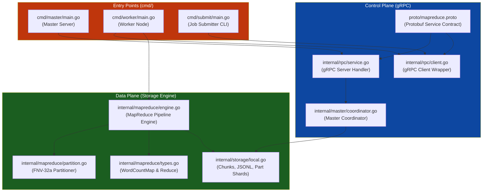
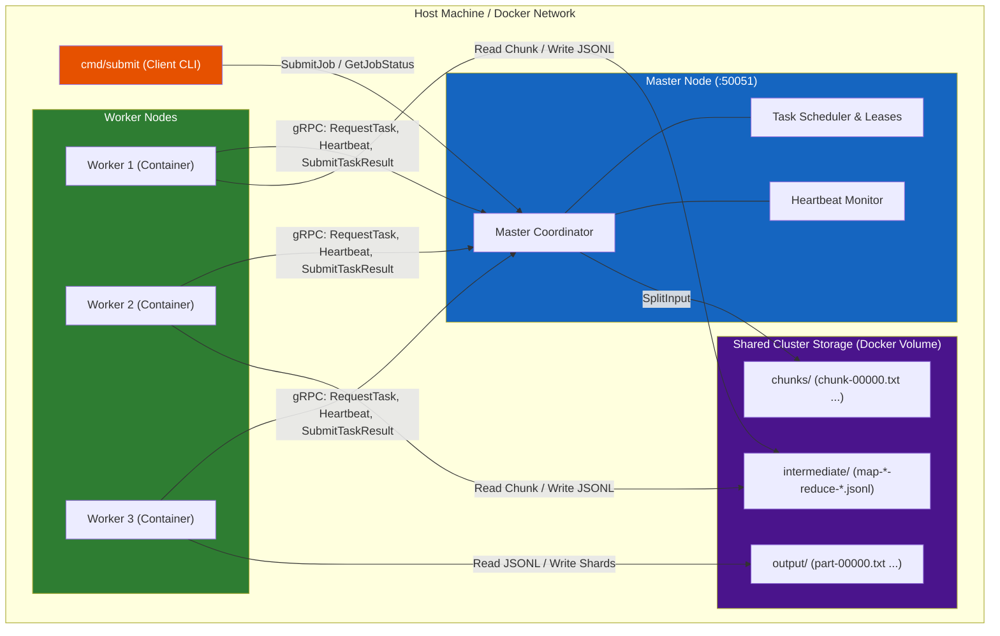
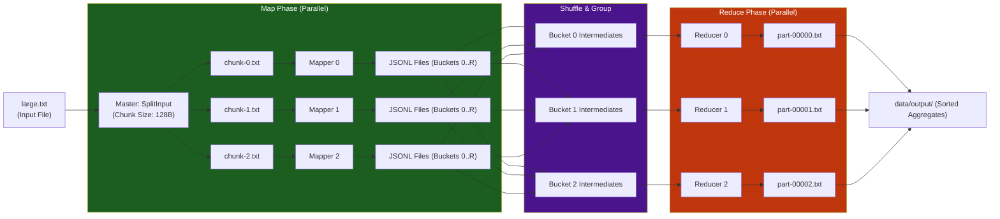
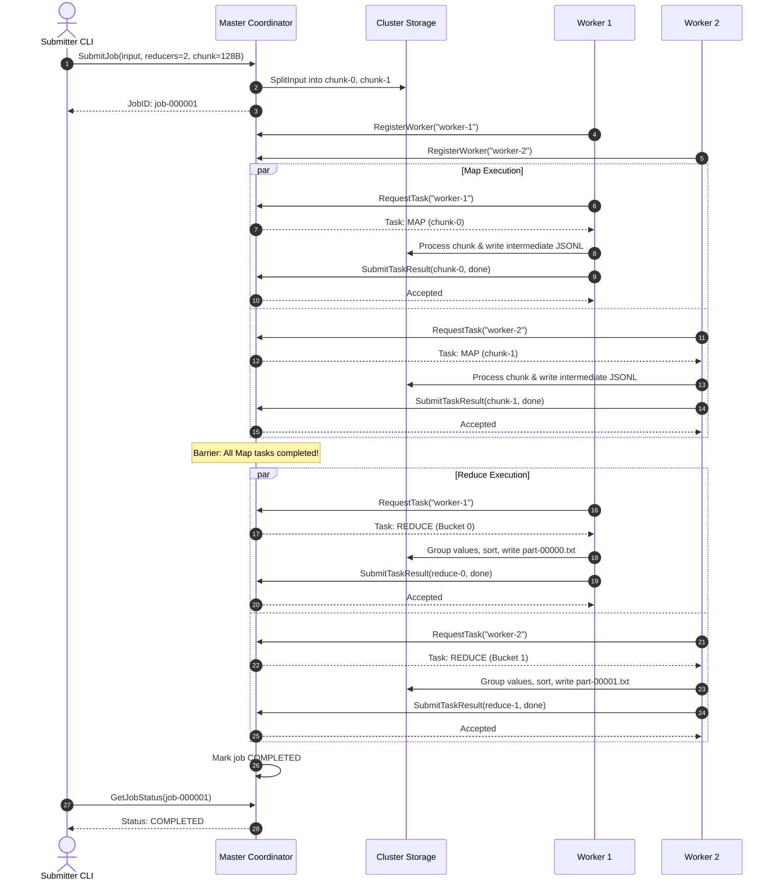
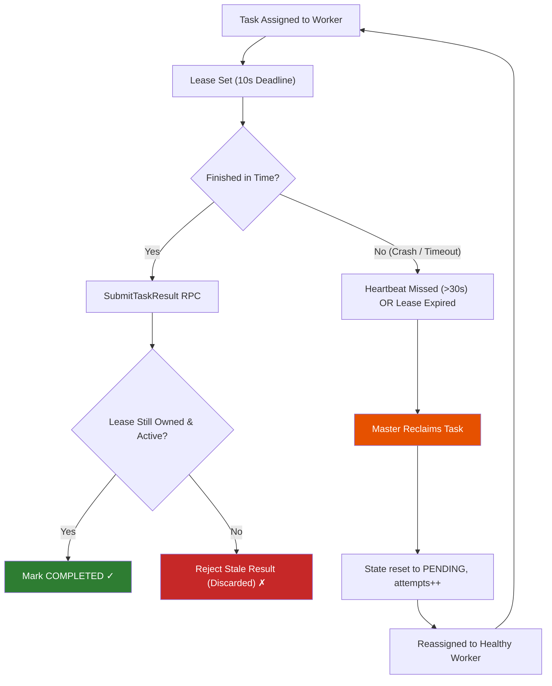

# 🚀 Mini MapReduce Engine (DS_MapRead)

[](https://go.dev/)
[](https://grpc.io/)
[](https://protobuf.dev/)
[](https://www.docker.com/)
[](LICENSE)

A production-grade miniature **MapReduce Distributed Execution Engine** implemented in **Go** and **gRPC**, modeling the core distributed systems principles from the seminal Google MapReduce paper (Dean & Ghemawat, 2004).

---

## 📌 Table of Contents

- [Goal of the Project](#-goal-of-the-project)
- [Key Features](#-key-features)
- [Distributed Systems Concepts](#-distributed-systems-concepts)
- [System Architecture](#-system-architecture)
- [Deployment & Connected Devices](#-deployment--connected-devices)
- [Data Flow Diagram (DFD)](#-data-flow-diagram-dfd)
- [Sequence Diagram](#-sequence-diagram)
- [Fault Tolerance & Recovery](#-fault-tolerance--recovery)
- [Main Algorithms (Pseudocode)](#-main-algorithms-pseudocode)
- [Repository Layout](#-repository-layout)
- [Quick Start](#-quick-start)
  - [1. Running with Docker Compose (Recommended)](#1-running-with-docker-compose-recommended)
  - [2. Running Locally on Bare Metal](#2-running-locally-on-bare-metal)
- [Verification & Testing](#-verification--testing)
- [Screenshots & Output](#-screenshots--output)
- [Interview & Viva Voce Guide](#-interview--viva-voce-guide)

---

## 🎯 Goal of the Project

The goal of this project is to build an educational yet architecturally rigorous **distributed batch-processing engine** from scratch. It solves the distributed **Word Count** problem by partitioning large text corpora across autonomous worker nodes, handling machine crashes, stragglers, and network delays through deterministic leases and heartbeats.

Key principles demonstrated:
- **Centralized Coordination:** Master node manages the lifecycle of tasks and workers.
- **Horizontal Scalability:** Pull-based task scheduling allows seamless worker scaling.
- **Resilience:** Automatic task reclaim on worker failure without data corruption.
- **Strong Typing & RPC:** Type-safe gRPC control plane over Protocol Buffers.

---

## ✨ Key Features

| # | Feature | Description |
|---|---|---|
| 1 | **gRPC Control Plane** | Real RPC interface for worker registration, task leases, heartbeats, and status queries. |
| 2 | **Line-Preserving Splitting** | Input is sliced into configurable byte chunks without truncating words across lines. |
| 3 | **Pull-Based Task Scheduling** | Workers request work; the master allocates pending tasks dynamically. |
| 4 | **FNV-32a Hash Partitioning** | Intermediate keys are deterministically routed to reducers (`hash(key) % R`). |
| 5 | **Two-Phase Barrier** | Map and Reduce phases are strictly separated by a distributed synchronization barrier. |
| 6 | **Task Leases** | Time-bounded execution leases (`10s` default). Expired leases are reassigned. |
| 7 | **Heartbeat Failure Detector** | Workers send heartbeats every `2s`. Workers silent for `30s` are marked dead. |
| 8 | **Stale Write Rejection** | Late submissions from expired worker leases are safely rejected to prevent split-brain. |
| 9 | **Structured JSON Logging** | Built-in `log/slog` observability tagging `job_id`, `task_id`, and `worker_id`. |
| 10 | **Dockerized Cluster** | 1 Master + 3 Workers running on an isolated virtual network with shared volume storage. |

---

## 🧠 Distributed Systems Concepts

### 1. Coordinator Pattern (Master–Worker)
A single coordinator node maintains global state (job statuses, task leases, and active workers). Workers are completely stateless compute engines. This avoids distributed consensus overhead while keeping state transitions straightforward.

### 2. Pull-Based Work Dispatching
Instead of the master pushing work to arbitrary workers, workers invoke `RequestTask` when idle. This naturally balances load across nodes with varying CPU speeds and network latencies.

### 3. Task Leases as Distributed Locks
When a task is leased, a deadline timestamp is registered. If the worker fails to respond before the lease expires, the master reclaims the task. This acts as an expiring lock, preventing deadlock on crashed nodes.

### 4. Heartbeats & Failure Detection
Workers run an asynchronous heartbeat loop (`every 2s`). If `now - lastHeartbeat > WorkerTimeout (30s)`, the master reclaims all in-flight tasks assigned to that worker.

### 5. Idempotent Retry & Determinism
Map and Reduce functions are purely functional (no external state mutations). Retrying a failed task on a different worker produces identical intermediate data.

### 6. Hash Partitioning (Shuffle Boundary)
Each mapper splits intermediate data into $R$ buckets using `FNV-32a(key) % R`. This guarantees all instances of any given key land on the exact same reducer without requiring an external shuffle service.

---

## 🏗 System Architecture



---

## 🌐 Deployment & Connected Devices

The cluster runs in Docker Compose or across independent machines on a local network:



---

## 🔄 Data Flow Diagram (DFD)



---

## ⏱ Sequence Diagram



---

## 🛡 Fault Tolerance & Recovery



---

## 📝 Main Algorithms (Pseudocode)

### 1. Scheduler (`RequestTask`)
```python
def RequestTask(worker_id):
    lock(master_mutex)
    reclaim_expired_leases(current_time)

    for job in active_jobs:
        # Phase 1: Map
        if not all_completed(job.map_tasks):
            task = get_pending_or_failed(job.map_tasks)
            if task:
                assign_lease(task, worker_id, timeout=10)
                unlock(master_mutex)
                return TaskResponse(MAP, task)
            continue # Wait for in-flight maps

        # Phase 2: Barrier & Reduce initialization
        if not job.reduce_tasks:
            job.reduce_tasks = build_reduce_tasks(job)

        # Phase 3: Reduce
        if not all_completed(job.reduce_tasks):
            task = get_pending_or_failed(job.reduce_tasks)
            if task:
                assign_lease(task, worker_id, timeout=10)
                unlock(master_mutex)
                return TaskResponse(REDUCE, task)
        else:
            job.status = COMPLETED

    unlock(master_mutex)
    return TaskResponse(WAIT)
```

### 2. Map Execution (`RunMap`)
```python
def RunMap(job_id, map_id, input_path, num_reducers):
    data = read_file(input_path)
    kv_pairs = MapFunction(input_path, data) # e.g. tokenize words

    buckets = [[] for _ in range(num_reducers)]
    for key, value in kv_pairs:
        b = FNV32a(key) % num_reducers
        buckets[b].append((key, value))

    output_files = []
    for r in range(num_reducers):
        sort_by_key(buckets[r])
        path = write_jsonl(f"map-{map_id}-reduce-{r}.jsonl", buckets[r])
        output_files.append(path)

    return output_files
```

### 3. Reduce Execution (`RunReduce`)
```python
def RunReduce(job_id, reduce_id, input_paths, output_dir):
    grouped = defaultdict(list)
    for path in input_paths:
        for key, val in read_jsonl(path):
            grouped[key].append(val)

    results = []
    for key in sorted(grouped.keys()):
        count = ReduceFunction(key, grouped[key]) # len(grouped[key])
        results.append((key, count))

    return write_tsv(f"{output_dir}/part-{reduce_id:05d}.txt", results)
```

---

## 📂 Repository Layout

```text
├── cmd/
│   ├── master/          # Coordinator entrypoint (gRPC server)
│   ├── worker/          # Worker process entrypoint
│   └── submit/          # Job submission CLI client
├── internal/
│   ├── master/          # Task scheduler, leases & state machine
│   ├── worker/          # Worker poll loop & heartbeat routine
│   ├── rpc/             # gRPC server/client bindings
│   ├── mapreduce/       # Map/Reduce engine, FNV-32a partitioning
│   ├── storage/         # Chunk splitting, JSONL & shard file I/O
│   └── utils/           # Structured slog logger
├── proto/
│   └── mapreduce.proto  # Canonical Protobuf contract (6 RPCs)
├── examples/
│   ├── large.txt        # Input dataset
│   └── expected-output.txt
├── test/
│   └── integration_test.go
├── docker-compose.yml   # Multi-container cluster orchestration
├── Dockerfile.master    # Master container spec
├── Dockerfile.worker    # Worker container spec
└── Makefile             # Automation targets
```

---

## ⚡ Quick Start

### 1. Running with Docker Compose (Recommended)

Run a complete distributed cluster (1 master + 3 workers) with a single command:

```bash
# Build and launch the cluster
docker compose up --build
```

The master auto-submits `examples/large.txt`. Once the master logs `job completed`:

```bash
# Inspect the generated output shards
docker compose exec master sh -c "cat /data/output/part-*.txt | sort | head -15"
```

Verify output matches expectations:
```bash
diff -u <(docker compose exec master sh -c "cat /data/output/part-*.txt | sort") examples/expected-output.txt
```

---

### 2. Running Locally on Bare Metal

Ensure you have **Go 1.22+** installed:

```bash
# Terminal 1: Start Master Coordinator
go run ./cmd/master -addr=:50051 -storage-root=data

# Terminals 2, 3, 4: Start Worker Nodes
go run ./cmd/worker -master=localhost:50051 -id=worker-1 -storage-root=data
go run ./cmd/worker -master=localhost:50051 -id=worker-2 -storage-root=data
go run ./cmd/worker -master=localhost:50051 -id=worker-3 -storage-root=data

# Terminal 5: Submit Word Count Job
go run ./cmd/submit -master=localhost:50051 \
    -input=examples/large.txt \
    -output=data/output \
    -reducers=3 \
    -chunk-size=128
```

---

## 🧪 Verification & Testing

Run all unit tests and integration tests with the Go race detector:

```bash
# Run unit tests across packages
go test -v ./...

# Run concurrency race detector
go test -race ./...

# Run integration tests
go test -v ./test/...
```

Expected output:
```text
=== RUN   TestInProcessClusterWordCount
--- PASS: TestInProcessClusterWordCount (0.15s)
=== RUN   TestExampleInputMatchesExpectedOutput
--- PASS: TestExampleInputMatchesExpectedOutput (0.08s)
PASS
ok      github.com/AkshataUbhale/DS_MapRead/test   0.231s
```

---

## 📸 Screenshots & Output

### 1. Master & Worker Startup
```json
{"time":"...","level":"INFO","component":"master","msg":"master listening","addr":":50051"}
{"time":"...","level":"INFO","component":"master","msg":"worker registered","worker_id":"worker-1"}
{"time":"...","level":"INFO","component":"master","msg":"worker registered","worker_id":"worker-2"}
{"time":"...","level":"INFO","component":"master","msg":"worker registered","worker_id":"worker-3"}
```

### 2. Parallel Map Execution
```json
{"time":"...","level":"INFO","component":"master","msg":"job submitted","job_id":"job-000001","chunks":6,"reducers":3}
{"time":"...","level":"INFO","component":"worker","worker_id":"worker-1","msg":"task started","task_id":"job-000001-map-00000","type":"MAP"}
{"time":"...","level":"INFO","component":"worker","worker_id":"worker-2","msg":"task started","task_id":"job-000001-map-00001","type":"MAP"}
{"time":"...","level":"INFO","component":"master","msg":"task completed","task_id":"job-000001-map-00000","worker_id":"worker-1"}
```

### 3. Fault Tolerance & Task Reclaim
```json
{"time":"...","level":"WARN","component":"master","msg":"task reclaimed","task_id":"job-000001-map-00001","worker_timeout":true}
{"time":"...","level":"INFO","component":"worker","worker_id":"worker-3","msg":"task started","task_id":"job-000001-map-00001","type":"MAP"}
```

### 4. Output Verification
```text
a               2
distributed     1
large           3
map             2
mapreduce       2
reduce          2
systems         3
workers         3
```

---

## 🎓 Interview & Viva Voce Guide

<details>
<summary><b>Click to expand 10 essential interview questions & answers</b></summary>
<br>

1. **What is MapReduce?**
   - A programming model for processing and generating large datasets using a parallel, distributed algorithm on a cluster.
2. **Why does this engine use pull-based scheduling?**
   - In pull scheduling, workers ask for work when idle. It automatically adapts to heterogeneous machine speeds, handles stragglers, and allows workers to scale up or down dynamically.
3. **What is a task lease?**
   - A time-bounded assignment given to a worker. If the worker does not complete within the lease window, the master assumes the worker crashed and re-queues the task.
4. **How are worker failures detected?**
   - Through periodic heartbeats (`every 2s`). If no heartbeat arrives within `WorkerTimeout (30s)`, active tasks are revoked.
5. **Why can tasks be safely retried?**
   - Because Map and Reduce functions are **pure and deterministic**. Given the same chunk, re-running generates identical intermediate files.
6. **How does partitioning work?**
   - Uses `FNV-32a(key) % num_reducers`. This ensures all pairs with the same key go to the exact same reducer.
7. **What is the Two-Phase Barrier?**
   - Reduce tasks cannot start until all Map tasks finish. This barrier prevents reducers from reading incomplete intermediate data.
8. **What prevents stale worker results from corrupting output?**
   - When a slow worker finally responds after its lease expired, the master verifies if the worker is still the active lease owner. If not, the submission is rejected.
9. **How is shared storage simulated?**
   - A Docker named volume (`mapreduce-data`) mounted across containers acts as a distributed filesystem stand-in for HDFS/S3.
10. **How would you productionize this engine?**
   - Add Raft-based master consensus for master failover, integrate Apache Arrow or S3 for object storage, and implement speculative execution for stragglers.
</details>

---

## 📜 References

1. **Dean, J., & Ghemawat, S. (2004).** *MapReduce: Simplified Data Processing on Large Clusters.* OSDI '04.
2. **Go Standard Library Documentation:** [https://go.dev/doc/](https://go.dev/doc/)
3. **gRPC Framework Guides:** [https://grpc.io/docs/](https://grpc.io/docs/)
4. **Fowler–Noll–Vo Hash Specification:** [http://www.isthe.com/chongo/tech/comp/fnv/](http://www.isthe.com/chongo/tech/comp/fnv/)

---

<p align="center">
  <b>Developed for Distributed Systems Mini-Project</b><br>
  Academic Year 2025–2026
</p>
